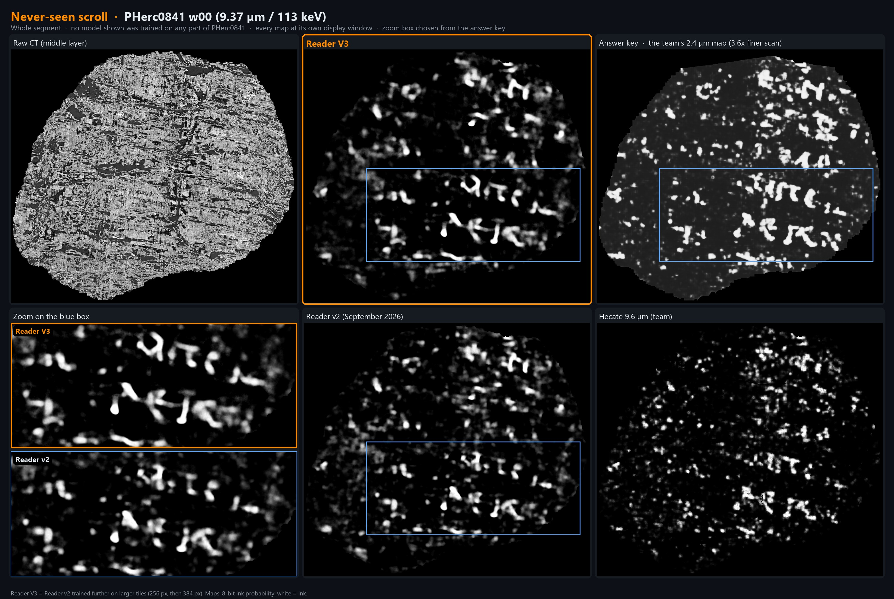
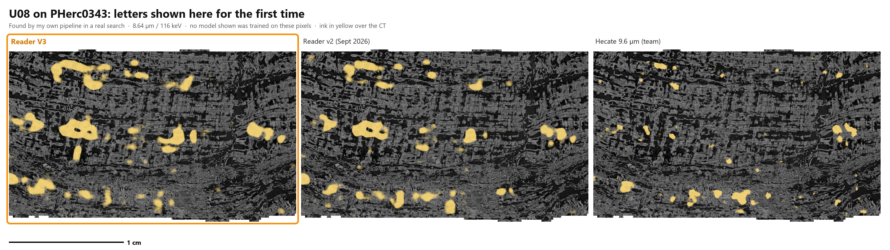
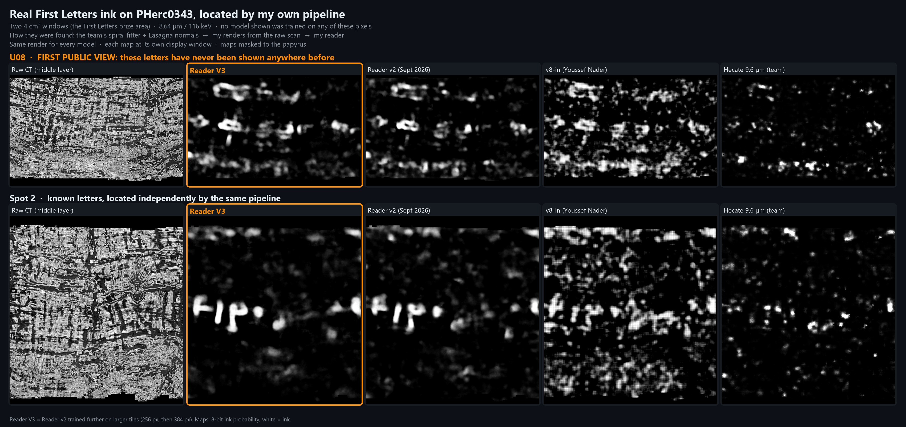
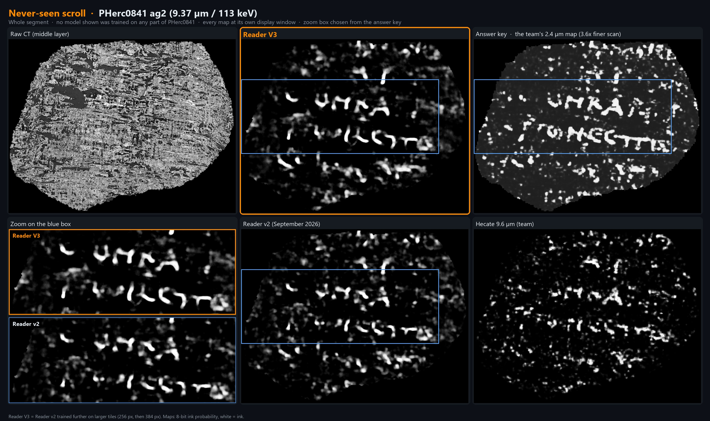
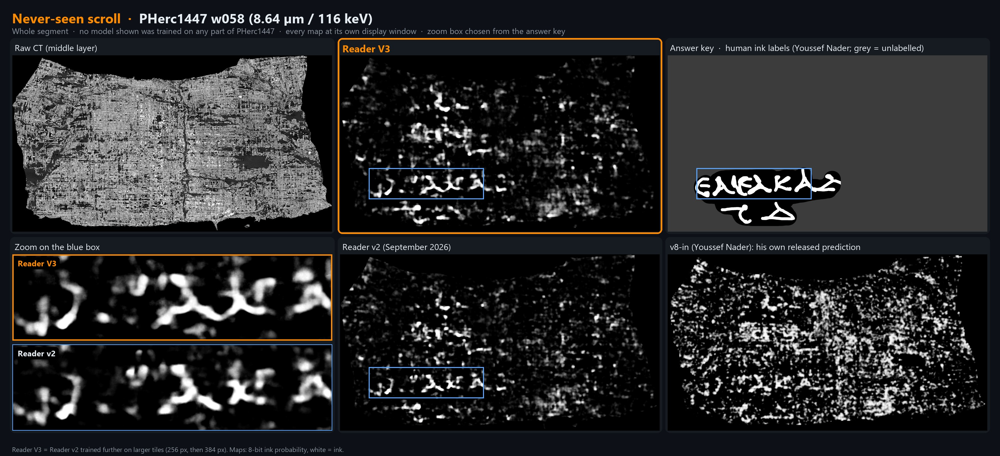
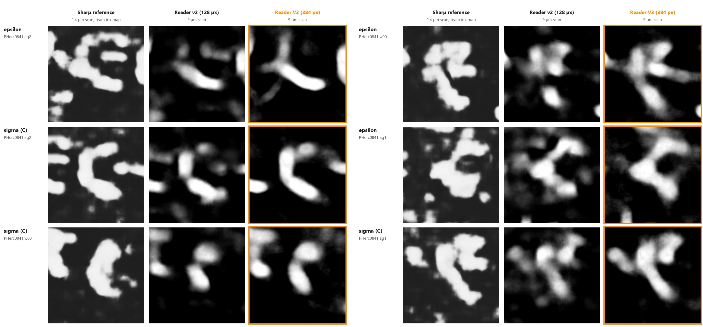
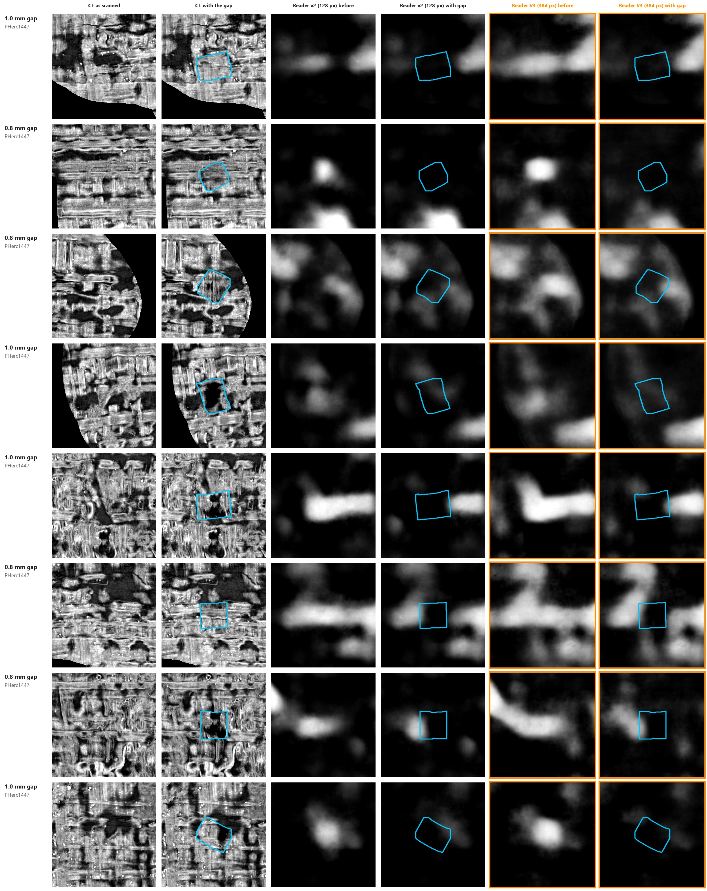
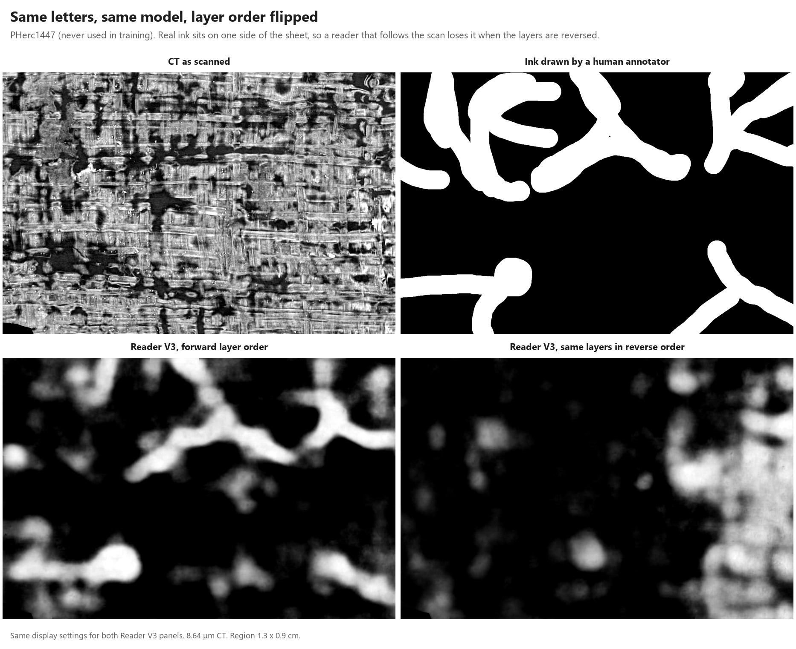

# Reader V3: clearer letters on scrolls it has never seen

**Letters that Reader v2 breaks apart, and that other 9 µm models blur into texture or speckle, come out whole and separate
with Reader V3, on scrolls it has never seen. It also puts down far less false ink and runs faster than Reader v2, v8-in
and the team's Hecate.**

A drop-in upgrade to [Reader v2](https://github.com/DomRusso2/reader-v2): one checkpoint for the team's own `ink_9um`
inference command, same CLI, nothing new to install.
Checkpoint: [huggingface.co/domenicor046/reader-v3](https://huggingface.co/domenicor046/reader-v3)



- **Never seen:** a whole segment of PHerc0841 (w00) at its native 9.37 µm. No model shown was trained on any part of
  PHerc0841; the team keeps the whole scroll for validation.
- **Checked against the answer key:** top right is the team's own ink map of the same papyrus from a 3.6x finer scan.
  Reader V3 brings out the same rows of letters as clean, separate strokes, where Reader v2 breaks more of them into
  fragments and Hecate into speckle.
- **No cherry-picking:** the zoom box is chosen from the answer key, never from a prediction.

## What V3 does better

- **Letters other models break apart come out whole.** On scrolls no model here was trained on, the strokes that Reader v2
  breaks apart, v8-in blurs into texture and Hecate reduces to dots stay whole and separate with Reader V3.
  ([See the pages](#whole-segments-never-seen).)
- **Letters nobody has seen before.** My own pipeline, run end to end on PHerc0343, located areas of letters by itself. One of
  them, **U08, is shown here for the first time anywhere**, and Reader V3 shows its letters more clearly than Reader v2,
  v8-in and Hecate. ([See them below](#real-first-letters-ink-found-in-a-real-search-pherc0343).)
- **Better than Reader v2 on every held-out test**, at both scan energies (113 and 116 keV). Every result here is on data the
  model never trained on.
- **Over 10x less false ink than Hecate, over 8x less than v8-in.** On blank papyrus at the same ink recall it marks **5.5%** of
  the papyrus as ink (Hecate 57.6%, v8-in 46.1%, Reader v2 9.2%), and on never-seen scrolls it marks the least background of
  any model compared (**30.4%** vs 35.3% to 38.8%). False ink is what sends a First Letters search after phantom letters.
- **The fastest of them all.** On the same page and GPU it finishes ahead of Reader v2, Hecate and v8-in, so a whole band of a
  scroll reads in about an hour.

## Why I built it

After seeing how widely Reader v2 was used across the community, I noticed this: First Letters work keeps landing on the same
few places of the same few scrolls, because that is where the ink is strong enough for today's 9 µm models. **Everywhere else
the ink is faint, and faint letters dissolve into speckle and false strokes.** Reader V3 goes after exactly that: letters that
separate cleanly from the papyrus on scrolls the model has never seen, so more of each scroll is worth reading.

## Real First Letters ink, found in a real search: PHerc0343

**U08: letters shown here for the first time anywhere.**

A benchmark is prepared in advance; a real search is not. In October I searched PHerc0343, one of the First Letters
scrolls, end to end with my own pipeline: the team's spiral fitter with Lasagna normals to follow the sheets, my own renders
straight from the raw scan, and my reader on every winding. The pipeline located two areas of letters by itself:

- **U08**, a row of letters that has never been shown anywhere before. This figure is its first public view.
- **Spot 2**, an area of known letters, located independently by the same pipeline.



*U08, ink in yellow over the CT (the style of the team's own First Letters images), one 4 cm² window, the same render for
every model. Reader V3 keeps the strokes whole, including the arc at top left and the short vertical stroke under the ring,
where Reader v2 breaks them into blobs and Hecate keeps only scattered dots.*



No model in the figure was trained on any of these pixels, Reader V3 included. That makes them the closest test I have to a real First Letters hunt:
real First Letters ink, found in a real search, the same render for every model and each map at its own display window. In
both areas Reader V3 gives the cleanest, most separate letters, where v8-in turns the rows into texture and Hecate keeps
only scattered dots.

## Whole segments, never seen

Zoomed crops can flatter any model, so every figure here is a whole segment of a scroll no model shown was trained on, every
map at its own display window, next to an answer key. The first one, PHerc0841 w00, opens this page ([back to it](#reader-v3-clearer-letters-on-scrolls-it-has-never-seen)).

### PHerc0841 ag2: two full rows of letters



*Reader V3 brings out two full rows of letters, the same rows the team's 3.6x finer scan shows. Reader v2 breaks many of
the strokes into fragments; Hecate shows speckle.*

### PHerc1447 w058



*8.64 µm / 116 keV, the scan protocol of about half of the scrolls still open for
First Letters. No model shown was trained on any part of
PHerc1447; the answer key is the human ink labels. The bottom right panel shows v8-in's own released prediction: the false
ink Reader V3 avoids.*

## Head-to-head

Same pixels, same masks, same metric for every model (`results/`). PHerc0841 and PHerc1447 were seen by none of these models.

| held-out test | **Reader V3** | Reader v2 | v8-in (stride 21) | Hecate 9.6 µm (team) |
|---|---|---|---|---|
| **Blank papyrus marked as ink** ↓ at the same ink recall, PHerc0139 w053 | **5.5%** | 9.2% | 46.1% | 57.6% |
| **Background marked as ink** ↓ at 80% human-label recall, never-seen 0841 + 1447 | **30.4%** | 35.4% | 38.8%* | 35.3% |
| 113 keV PHerc0139 w047, AUC ↑ | **0.930** | 0.897 | 0.809 | 0.776 |
| 116 keV PHerc0009B, AUC vs human labels ↑ | **0.943** | 0.927 | 0.870 | 0.893 |

↓ lower is better, ↑ higher is better. \* v8-in at stride 42 on all five windows (stride 21 on the two 1447 windows alone: 34.2%).

**The clearest letters in every figure above, the fewest false alarms, the fastest, and ahead of Reader v2 on every held-out
test.** Per-region AUC for every model on every window is in `results/`.

## Checking that the larger context does not invent strokes

Training on 384 px tiles gives the model more of the sheet around each stroke. I ran three checks to make sure it uses that
context to read the ink, not to invent strokes or close a letter (a c turned into an o), each time next to Reader v2
(128 px) and on scrolls neither model was trained on.



**Open letters stay open.** PHerc0841 also has a 2.4 µm scan, much sharper than the 9 µm scan the models read. On e's and
c's that are clearly visible in the sharp scan (the team's ink map), Reader V3 keeps the letters open the same way Reader
v2 does, and draws one c more cleanly than v2. Nothing edited.



**Cut gaps stay open.** I cut gaps about the size of a letter opening (0.8 to 1 mm) into real PHerc1447 strokes and filled
them with blank papyrus from the same sheet. In these examples Reader V3 keeps the gap open just like Reader v2.



**The strokes come from the scan.** To invent letters the model would have to imagine whole Greek letters. With the same
layers read in reverse order, the letter shapes go away (PHerc1447 w058, human ink labels from
[Youssef Nader's 1447 surfaces](https://huggingface.co/datasets/YoussefMoNader/ink-8um-pherc1447-surfaces)).

## Get it and run it

If you already run the team's `ink_9um` models, only the checkpoint changes:

```bash
hf download domenicor046/reader-v3 reader-v3.pth --local-dir .
python -m koine_machines.inference.infer <surface_volume.zarr> reader-v3.pth out.tif --overlap 0.5 --blend-mode hann --direction both
```

- **Setup:** `koine_machines` is the team's package: `ink-detection/` on the `merge-ink-pipelines` branch of
  [villa](https://github.com/ScrollPrize/villa), installed with `pip install -e ink-detection` (it also needs villa's
  `vesuvius` package). On Windows add `--no-compile`.
- **Input:** a rendered surface volume (OME-Zarr, layers along the surface normal), the same input as for `ink_9um`, on the
  native 9.36 µm or 8.64 µm scans. Render it from the raw scan or a near-lossless copy.
- **Output:** `--direction both` reads the layers in both orders and writes `out.tif` and `out_reverse.tif` (8-bit ink
  score, white = ink). Which order is right depends on which face of the papyrus the render starts from: keep the
  one that shows letters.
- **Reading the values:** they are a relative ink score, not a calibrated probability. Training used label smoothing 0.5
  (the team's default), so outputs sit around 0.25 to 0.75 (about 64 to 191 in the 8-bit file). Use 0.5 (128) as the cut,
  or stretch each segment from its median to its 99.5th percentile, as every figure here is shown.
- **Optional:** the CLI's own `--tta-mirror` flag adds a little AUC (tested on the earlier checkpoint) and takes longer; it
  made no visible difference to the letters.

## What changed from Reader v2

One deliberate change: more context. Reader v2 reads the papyrus in 128 px tiles, so it sees each stroke in pieces and has
to guess whether a smudge is ink or papyrus fibre. Reader V3 is Reader v2 trained further on larger tiles, 30k iterations
at 256 px and then 20k at 384 px (config in `train_config.json`). With more of the sheet around each stroke, it can join
the pieces of a stroke and reject background that only looks like ink: the 256 px step brought the clearer letters, the
384 px step added AUC and removed false alarms on every test. The architecture, the training data and the labels stayed
the same ([reader-v2-labels](https://huggingface.co/datasets/domenicor046/reader-v2-labels)), so the gains come from
training on larger tiles, not from new data. Larger tiles also mean far fewer tiles per page, one reason V3 reads a page
faster than Reader v2.

## Limits

- The faintest 1447 window (w060) is not legible for any 9 µm model I tested.
- The figures compare readers on known text and blank papyrus; they rank readers, they do not prove text anywhere.
- PHerc0343's First Letters prize has already been awarded, for text elsewhere on the scroll; U08 and spot 2 are shown as a
  test of the reader, not as a prize claim.

## Re-check every number

`python scripts/verify_release_numbers.py` checks every number and percentage in this README against the evaluation
outputs in `results/` and prints ALL NUMBERS VERIFIED.

## Files

`checkpoints/reader-v3.pth`, `train_config.json`, `results/` (per-region numbers for every model), `figures/`,
`scripts/speed_bench.py` (how the speed test was run), `scripts/verify_release_numbers.py` (checks every number in this README against `results/`).

MIT licence. Author: Domenico Russo.
